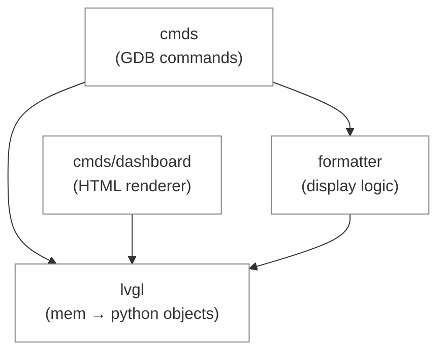

# lvglgdb

GDB Python extension for inspecting and debugging LVGL internals.
Works with live debugging sessions, core dumps, and other
GDB-compatible targets.

## Installation

The plugin is plain Python with no dependencies beyond the standard library,
so it runs in any GDB that has Python support, and nothing has to be
installed.

The whole plugin is also packed into a single file. Download it from the LVGL
release branch that matches your LVGL version:

```bash
curl -LO https://raw.githubusercontent.com/lvgl/lvgl/release/v9.6/scripts/gdb/bundle/lvglgdb.py
```

(or open
[the file on GitHub](https://github.com/lvgl/lvgl/blob/release/v9.6/scripts/gdb/bundle/lvglgdb.py)
and use "Download raw file"), then load it in GDB:

```bash
source lvglgdb.py
```

If your project already contains LVGL, load the plugin from its sources
instead:

```bash
source lvgl/scripts/gdb/gdbinit.py
```

To load it in every session, put the `source` line in `~/.gdbinit`.

The plugin's version follows the LVGL release it ships with, but it also reads
targets built from older LVGL versions.

## Usage

### Dump Commands

Where a command takes a widget, style, class or layer, any C expression GDB can
evaluate will do: a variable, a member chain, or a plain address.

```bash
dump obj                        # Dump widget tree (same listing as `info widget`)
dump obj -L 2                   # ...limited to 2 levels
dump obj main_screen_0          # ...starting from one widget
dump display -f png             # Dump display framebuffer as PNG
dump display -p /tmp/ -f bmp    # ...with a path prefix
dump cache image                # Dump image cache entries
dump cache image_header         # Dump image header cache entries
check cache image               # Validate image cache integrity
check cache image_header        # Validate image header cache integrity
dump anim                       # Dump active animations
dump anim --detail              # ...one detailed block per animation
dump timer                      # Dump registered timers
dump indev                      # Dump input devices
dump group                      # Dump focus groups
dump image_decoder              # Dump registered image decoders
dump fs_drv                     # Dump filesystem drivers
dump draw_task lv_global->disp_default->layer_head   # Draw tasks of a layer
dump dashboard                  # Generate interactive HTML dashboard
dump dashboard -o out.html      # Save dashboard to file
dump dashboard --json           # Export the raw data as JSON
dump dashboard --viewer         # Empty HTML viewer that loads JSON files
dump widget props lv_keyboard   # Which fields a widget class has
dump widget props my_obj        # ...or the class of a live widget
dump widget props               # List the widget classes
```

### Info Commands

```bash
info lvgl_version               # LVGL version of the target, and this plugin's version
info widget                     # List every widget, indented by tree depth
info widget my_obj              # All fields of one widget, incl. its own struct
info widget 0x50e000000820      # ...an address works as well as a variable
info widget my_obj text         # Only the named field(s)
info widget ball_1              # Find it by name, anywhere on any screen
info widget label3 -p screen_1/button_2   # ...or by name below a parent path
info widget screen_1/button_2/label3      # ...or by a full name path
info widget my_obj --tree -L 2  # Subtree of one widget instead of its details
info style my_style             # Inspect a single lv_style_t
info style --obj my_obj         # Inspect all styles of an lv_obj_t
                                # sizes as 100%/content, enums and fonts by name
info draw_unit                  # Show draw unit information
info obj_class &lv_button_class # Show object class hierarchy
info obj_class --all            # List all registered object classes
info subject &my_subject        # Show subject and its observers
```

### Other Commands

```bash
lvglobal                        # NuttX (needs nxgdb): find the LVGL instance
lvglobal --pid 3                # ...of a given process in multi-process mode
debugger -t vscode              # Attach an IDE debugger to the plugin itself
```

### Dashboard

`dump dashboard` generates a self-contained HTML file with an interactive 3D
layer view, widget tree, style inspector, cache stats, animation list, and
draw buffer previews (RGB565 / RGB888 / ARGB8888 / XRGB8888).

## Regenerating the constant tables

The style, flag, state, event and widget tables are generated from the LVGL
headers, not written by hand. After changing an enum or adding a widget field,
regenerate them from this directory:

```bash
python3 scripts/generate_all.py
```

The headers are taken from the nearest LVGL checkout above this one. Set
`LVGL_ROOT` to read a different one — either a checkout or an installed tree
that only has the public headers under `include/lvgl/`:

```bash
LVGL_ROOT=~/lvgl python3 scripts/generate_all.py
```

A generator that cannot find LVGL stops with an error rather than writing an
empty table over a good one. Regenerating rewrites every table, so check the
full diff: a parsing change that looks harmless for one table can quietly empty
another.

## Rebuilding the single-file bundle

`bundle/lvglgdb.py` is generated from the `lvglgdb/` package. After any change
to the plugin, rebuild it from this directory and commit it together with the
change; CI fails if the committed bundle is out of date:

```bash
python3 build_bundle.py
```

## Tests

```bash
python3 -m unittest discover tests
```

The decoders and the generator helpers are pure Python, so these run without a
target and without GDB.

## Structure


